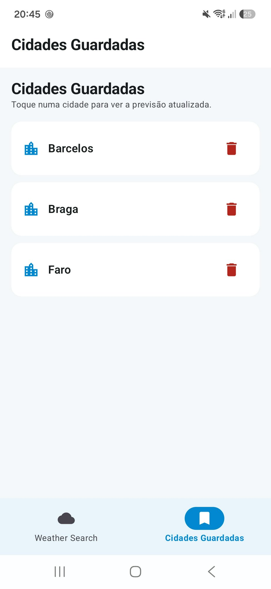

# Weather Search 🌤️

<div align="center">
  
  
  <h3>Aplicação Android de Consulta e Previsão Meteorológica</h3>
  <p>Desenvolvida em <strong>Kotlin</strong> com <strong>Jetpack Compose</strong>, consumo REST assíncrono via <strong>OkHttp</strong> e navegação com <strong>Navigation Compose</strong>.</p>

  [](https://github.com/Brito21x)
  [](https://developer.android.com/)
  [](https://kotlinlang.org/)
  [](https://developer.android.com/jetpack/compose)
  [](https://m3.material.io/)
  [](https://square.github.io/okhttp/)
  [](https://developer.android.com/)
  [](https://developer.android.com/)
</div>

---

## 📋 Índice
- [Sobre o Projeto](#-sobre-o-projeto)
- [Funcionalidades Principais](#-funcionalidades-principais)
- [Demonstração Visual](#-demonstração-visual)
- [API Utilizada (WeatherAPI)](#-api-utilizada-weatherapi)
- [Especificações Técnicas](#-especificações-técnicas)
- [Requisitos Cumpridos](#-requisitos-cumpridos)
- [Boas Práticas de Engenharia](#-boas-práticas-de-engenharia)
- [Estrutura do Projeto](#-estrutura-do-projeto)
- [Instalação e Execução](#-instalação-e-execução)
- [Tecnologias Utilizadas](#-tecnologias-utilizadas)
- [Autor](#-autor)

---

## 📖 Sobre o Projeto
O **Weather Search** é uma aplicação nativa para Android construída segundo as diretrizes modernas de desenvolvimento mobile da Google. Combina uma interface totalmente declarativa em **Jetpack Compose** com a robustez do cliente de rede **OkHttp**, proporcionando uma experiência de utilizador rápida, fluida e responsiva.

A aplicação consome a API REST da **WeatherAPI**, processando os dados meteorológicos fora da *Main Thread* e estruturando a navegação através do padrão **Lista → Detalhe**, com suporte para pesquisa de cidades portuguesas e geolocalização automática via GPS.

---

## ✨ Funcionalidades Principais
* **Tempo Atual em Destaque**:
  * Apresentação da localidade e país (`location.name`, `location.country`).
  * Temperatura atual em tempo real (`current.temp_c`).
  * Condição meteorológica detalhada e ícone dinâmico (`current.condition.text`, `current.condition.icon`).
* **Detalhes Rápidos**:
  * Sensação térmica em °C (`current.feelslike_c`).
  * Humidade relativa do ar em % (`current.humidity`).
  * Velocidade do vento em km/h (`current.wind_kph`).
* **Pesquisa de Cidades com Filtro Portugal**:
  * Caixa de pesquisa com sugestões rápidas para cidades nacionais (*Barcelos*, *Braga*, *Porto*, *Lisboa*, *Coimbra*, *Faro*, *Funchal*).
  * Normalização de pesquisa que prioriza localidades de Portugal e evita sobreposição com cidades homónimas internacionais.
* **Geolocalização Automática via GPS**:
  * Deteção das coordenadas do dispositivo com a biblioteca Google Play Services Location (`FusedLocationProviderClient`).
* **Previsão Diária (Padrão Lista → Detalhe)**:
  * Lista diária implementada com `LazyColumn` e itens reutilizáveis (`ForecastDayRow`).
  * Navegação para ecrã de detalhe (`ForecastDetailScreen`), apresentando os dados consolidados do dia:
    * Data e dia da semana.
    * Temperaturas máxima, mínima e média (`maxtemp_c`, `mintemp_c`, `avgtemp_c`).
    * Probabilidade de precipitação em % (`daily_chance_of_rain`).
    * Humidade e vento.
* **Cidades Guardadas (Favoritos)**:
  * Sistema de marcação rápida de cidades na barra de topo com persistência local em `SharedPreferences`.
  * Ecrã dedicado acessível através da barra de navegação inferior.
* **Partilha Nativa de Boletim**:
  * Ação integrada para envio do resumo meteorológico via Android Sharesheet (`Intent.ACTION_SEND`).
* **Feedback de Interface (UI States)**:
  * Tratamento para todos os estados de ecrã: *Loading*, *Success*, *Empty* e *Error* (com botão para nova tentativa).

---

## 📱 Demonstração Visual

<div align="center">
  <table>
    <tr>
      <td align="center" width="50%"><strong>Ecrã Principal (Weather Search)</strong></td>
      <td align="center" width="50%"><strong>Cidades Guardadas (Favoritos)</strong></td>
    </tr>
    <tr>
      <td align="center">
        
      </td>
      <td align="center">
        
      </td>
    </tr>
    <tr>
      <td valign="top">
        <strong>Funcionalidades Apresentadas:</strong>
        <ul>
          <li><strong>Barra de Pesquisa</strong>: Caixa com suporte a limpeza rápida e botão para geolocalização GPS automática.</li>
          <li><strong>Sugestões Rápidas</strong>: Chips horizontais para cidades portuguesas (<em>Barcelos, Braga, Porto, Lisboa</em>).</li>
          <li><strong>Cartão Meteorológico</strong>: Gradiente azul com localidade (<em>Barcelos, Portugal</em>), temperatura atual (16°C), sensação térmica e ícone da condição.</li>
          <li><strong>Detalhes Rápidos</strong>: Cartões de Sensação (13°C), Humidade (95%) e Vento (26 km/h).</li>
          <li><strong>Lista de Previsão Diária</strong>: Coleção <code>LazyColumn</code> com previsões futuras e navegação para detalhe.</li>
          <li><strong>TopBar Integrada</strong>: Botão de marcador para adicionar aos favoritos e botão de partilha do boletim.</li>
        </ul>
      </td>
      <td valign="top">
        <strong>Funcionalidades Apresentadas:</strong>
        <ul>
          <li><strong>Lista de Favoritos</strong>: Cidades guardadas localmente pelo utilizador (<em>Barcelos, Braga, Faro</em>).</li>
          <li><strong>Consulta Imediata</strong>: Ao tocar em qualquer cartão, a aplicação carrega a previsão do tempo dessa cidade.</li>
          <li><strong>Eliminação Rápida</strong>: Botão de eliminação direta para gerir a lista de localidades guardadas.</li>
          <li><strong>Navegação Reativa</strong>: Barra inferior com <code>NavigationBar</code> e sincronização direta com a rota ativa do <code>NavController</code>.</li>
        </ul>
      </td>
    </tr>
  </table>
</div>

---

## 🌐 API Utilizada (WeatherAPI)
A aplicação consome os serviços da [WeatherAPI](https://www.weatherapi.com/), um fornecedor global de dados meteorológicos em tempo real e de previsão.

### Endpoint Consumido
```http
GET https://api.weatherapi.com/v1/forecast.json?key={API_KEY}&q={CIDADE}&days={DIAS}&aqi=no&alerts=no&lang=pt
```

### Parâmetros da Requisição
| Parâmetro | Tipo | Descrição |
| :--- | :--- | :--- |
| `key` | `String` | Chave de autenticação única fornecida pelo portal WeatherAPI. |
| `q` | `String` | Query de localização (nome da cidade formatado ou coordenadas `latitude,longitude`). |
| `days` | `Int` | Quantidade de dias de previsão solicitados (configurado para 5 dias). |
| `aqi` | `String` | Define se inclui dados de qualidade do ar (`no` para otimizar o payload JSON). |
| `alerts` | `String` | Define se inclui alertas governamentais extensos (`no` para manter a resposta leve). |
| `lang` | `String` | Código do idioma para as descrições meteorológicas (`pt` para português). |

### Estrutura de Dados Mapeada
* **Localização (`location`)**:
  * `location.name`: Nome oficial da localidade (ex.: *"Barcelos"*).
  * `location.country`: País correspondente (ex.: *"Portugal"*).
* **Tempo Atual (`current`)**:
  * `current.temp_c`: Temperatura atual em graus Celsius.
  * `current.condition.text`: Descrição legível em português (ex.: *"Parcialmente nublado"*).
  * `current.condition.icon`: URL do ícone meteorológico (prefixado com `https:`).
  * `current.feelslike_c`: Sensação térmica atual em °C.
  * `current.humidity`: Humidade relativa do ar em percentagem (%).
  * `current.wind_kph`: Velocidade do vento em km/h.
* **Previsão Diária (`forecast.forecastday`)**:
  * `date`: Data no formato ISO (`YYYY-MM-DD`).
  * `day.maxtemp_c` e `day.mintemp_c`: Temperaturas máxima e mínima previstas.
  * `day.avgtemp_c`: Temperatura média estimada para o dia.
  * `day.daily_chance_of_rain`: Probabilidade de ocorrência de chuva em percentagem (%).
  * `day.condition.icon` e `day.condition.text`: Ícone e descrição do tempo previsto.

---

## 📊 Especificações Técnicas

| Parâmetro | Detalhe |
| :--- | :--- |
| **Arquitetura** | MVVM modular (Package-by-Feature) + Repository Pattern + Unidirectional Data Flow (UDF) |
| **Toolkit de UI** | 100% Jetpack Compose com Material Design 3 |
| **Linguagem** | Kotlin 2.2.10 |
| **Cliente de Rede** | OkHttp 4.12.0 (Chamadas assíncronas via `enqueue`) |
| **Parser JSON** | Google Gson 2.11.0 |
| **Carregador de Imagens** | Coil Compose 2.7.0 (com salvaguarda para Previews nativas) |
| **Requisitos Mínimos** | Android 7.0 (API 24) |
| **Target SDK** | Android 15 / 16 Preview (API 37) |
| **Gestão de Dependências** | Gradle Version Catalogs (`libs.versions.toml`) |

---

## 🛠️ Requisitos Cumpridos

### 1. Consumo de APIs REST com OkHttp
- [x] Configuração da dependência **OkHttp** e permissão `android.permission.INTERNET`.
- [x] Execução de pedidos HTTP GET de forma assíncrona fora da Main Thread através de **`enqueue()`**.
- [x] Processamento de respostas JSON e mapeamento para modelos Kotlin tipados com **Gson**.
- [x] Exposição do resultado à Compose UI via ViewModels dedicados por ecrã (**`HomeViewModel`**, **`FavoritesViewModel`**, **`ForecastDetailViewModel`**) e **`StateFlow`** consumidos com **`collectAsState()`**.
- [x] Tratamento robusto de falhas de rede (DNS, timeout, perda de ligação) e códigos HTTP inesperados.

### 2. Padrão Lista → Detalhe em Compose
- [x] Exibição de coleções com **`LazyColumn`** e itens reutilizáveis (**`ForecastDayRow`**).
- [x] Modelagem de dados de domínio desacoplados da camada de rede (**`WeatherDomain`**, **`ForecastDayDomain`**).
- [x] Navegação de um item da lista para um ecrã de detalhe (**`ForecastDetailScreen`**) com dados do item selecionado.
- [x] Tratamento determinístico de estados de interface via **`HomeViewState`** (*searchQuery*, *weather*, *errorMessage*, *isLoading*).
- [x] Separação do Composable da linha da lista e do ecrã de detalhe em ficheiros e pacotes modulares distintos.

### 3. Navegação Multi-Ecrã com Navigation Compose
- [x] Definição de rotas tipadas através de **`sealed class Screen`** e grafo com **`NavHost`** / **`NavController`** integrado em **`MainActivity.kt`**.
- [x] Organização estrutural com **`Scaffold`** (`topBar`, `bottomBar`, conteúdo).
- [x] Barra de navegação inferior com **`NavigationBar`** e **`NavigationBarItem`** sincronizada com o estado da rota atual.
- [x] Barra superior dinâmica (**`WeatherTopBar`**) com título adaptativo, botão voltar e ações reativas de partilha e favoritos.
- [x] Distinção de ecrãs base e ecrãs de detalhe (`isBaseScreen`, `popBackStack()`).

---

## 💡 Boas Práticas de Engenharia
* **Zero Bloqueios na Main Thread**: Todo o processamento de rede e parsing de dados corre em threads secundárias do pool do OkHttp.
* **Single Source of Truth (SSOT)**: O repositório central (`WeatherRepository`) é a única fonte de verdade para cache em memória e persistência local, evitando duplicação de dados.
* **Arquitetura Modular por Funcionalidade (Package-by-Feature)**: Cada ecrã possui o seu próprio ViewModel e estado (`ui/home`, `ui/favorites`, `ui/detail`), eliminando o anti-padrão do "God ViewModel" e garantindo escalabilidade.
* **Desacoplamento Rigoroso da Camada de UI**: Os ViewModels são puros e não retêm referências a `Context` nem constroem `Intent`s; a abertura do sistema de partilha nativo é orquestrada na camada de UI.
* **Reatividade com Kotlin Coroutines & Flow**: Uso de `StateFlow` e do operador `combine` para reatividade imediata no ícone de favoritos da barra superior.
* **Suporte a Previews no Android Studio**: Todos os componentes visuais contêm funções `@Preview` operacionais (sem falhas de LayoutLib por recurso ao `LocalInspectionMode`).
* **Design Edge-to-Edge**: Aplicação configurada com `enableEdgeToEdge()` para integração total com barras de estado e navegação do sistema.
* **Ícones Adaptativos**: Ícone oficial com suporte a máscaras dinâmicas (círculo, quadrado e squircle) em Android 8.0+.

---

## 📁 Estrutura do Projeto

```text
app/src/main/java/upca/example/weathersearch/
│
├── MainActivity.kt                 # Ponto de entrada Android, Scaffold e Grafo de Navegação (WeatherApp)
│
├── data/
│   ├── model/
│   │   └── WeatherModels.kt        # DTOs da API e Modelos de Domínio
│   ├── network/
│   │   └── WeatherApiClient.kt     # Cliente OkHttp com enqueue assíncrono
│   └── repository/
│       └── WeatherRepository.kt    # Repositório de dados e preferências
│
├── navigation/
│   └── Screen.kt                   # Sealed class de rotas e destinos
│
├── ui/
│   ├── components/                 # Componentes de interface modulares e reutilizáveis
│   │   ├── CurrentWeatherCard.kt   # Cartão de destaque do tempo atual
│   │   ├── ForecastDayRow.kt       # Linha da lista de previsão diária
│   │   ├── WeatherBottomBar.kt     # Barra de navegação inferior
│   │   ├── WeatherIcon.kt          # Ícone com salvaguarda nativa para Previews
│   │   ├── WeatherStateViews.kt    # Vistas de Loading, Error e Empty
│   │   └── WeatherTopBar.kt        # Barra superior com ações de voltar, partilhar e favoritar
│   │
│   ├── detail/                     # Ecrã de detalhe
│   │   ├── ForecastDetailScreen.kt # Ecrã com dados meteorológicos detalhados do dia
│   │   └── ForecastDetailViewModel.kt # ViewModel e ForecastDetailViewState
│   │
│   ├── favorites/                  # Ecrã de cidades guardadas
│   │   ├── FavoritesScreen.kt      # Ecrã de listagem e remoção de favoritos
│   │   └── FavoritesViewModel.kt   # ViewModel e FavoritesViewState
│   │
│   ├── home/                       # Ecrã principal da aplicação
│   │   ├── HomeScreen.kt           # Ecrã principal com pesquisa e LazyColumn
│   │   └── HomeViewModel.kt        # ViewModel e HomeViewState
│   │
│   └── theme/                      # Tema visual e design system Material 3
│       ├── Color.kt                # Paleta de cores do Weather Search
│       ├── Theme.kt                # Configuração do tema claro e escuro
│       └── Type.kt                 # Tipografia do Compose
```

---

## 🚀 Instalação e Execução

### 1. Clonar o Repositório
```bash
git clone https://github.com/Brito21x/WeatherSearch.git
cd WeatherSearch
```

### 2. Configurar a Chave da API
Crie ou edite o ficheiro `local.properties` na raiz do projeto e configure a sua chave da WeatherAPI:
```properties
WEATHER_API_KEY=sua_api_key_aqui
```

### 3. Compilação
Execute o build do projeto através do Gradle Wrapper:

```powershell
# No Windows:
.\gradlew.bat assembleDebug

# No macOS / Linux:
./gradlew assembleDebug
```

O ficheiro APK compilado estará disponível em:
```text
app/build/outputs/apk/debug/app-debug.apk
```

---

## 🧰 Tecnologias Utilizadas
* **Linguagem**: [Kotlin 2.2.10](https://kotlinlang.org/)
* **Interface Gráfica**: [Jetpack Compose](https://developer.android.com/jetpack/compose) com [Material 3](https://m3.material.io/)
* **Navegação**: [Navigation Compose 2.8.5](https://developer.android.com/jetpack/compose/navigation)
* **Cliente HTTP**: [OkHttp 4.12.0](https://square.github.io/okhttp/) (Pedidos assíncronos com `enqueue`)
* **Desserialização JSON**: [Gson 2.11.0](https://github.com/google/gson)
* **Carregamento de Imagens**: [Coil Compose 2.7.0](https://coil-kt.github.io/coil/compose/)
* **Localização**: [Google Play Services Location 21.3.0](https://developers.google.com/android/guides/setup)

---

## 👤 Autor
Desenvolvido por **[@Brito21x](https://github.com/Brito21x)**.
