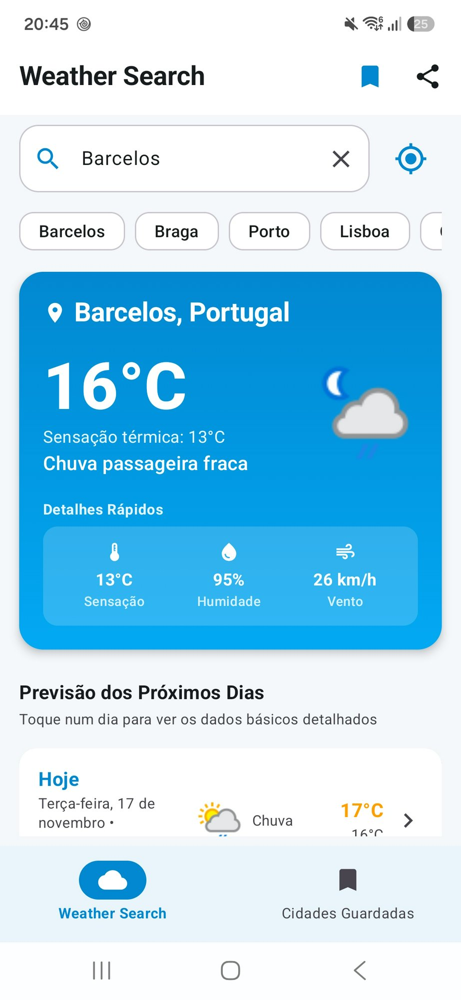

# Weather Search

<div align="center">
  

  <h3>Native Android Weather Forecast Application</h3>
  <p>Built in <strong>Kotlin</strong> with <strong>Jetpack Compose</strong>, asynchronous REST networking via <strong>OkHttp</strong>, and multi-screen navigation using <strong>Navigation Compose</strong>.</p>

  <p>
    <a href="https://github.com/Brito21x"></a>
    <a href="https://developer.android.com/"></a>
    <a href="https://kotlinlang.org/"></a>
    <a href="https://developer.android.com/jetpack/compose"></a>
    <a href="https://m3.material.io/"></a>
    <a href="https://square.github.io/okhttp/"></a>
    <a href="https://developer.android.com/"></a>
    <a href="https://developer.android.com/"></a>
  </p>
</div>

---

## Table of Contents

- [Overview](#overview)
- [Key Features](#key-features)
- [Screenshots](#screenshots)
- [System Architecture](#system-architecture)
- [Weather API Integration](#weather-api-integration)
- [Technical Specifications](#technical-specifications)
- [Core Implementation Highlights](#core-implementation-highlights)
- [Engineering Best Practices](#engineering-best-practices)
- [Project Structure](#project-structure)
- [Getting Started](#getting-started)
- [Tech Stack](#tech-stack)
- [Author](#author)

---

## Overview

**Weather Search** is a native Android application built following Google's modern mobile architecture guidelines. It pairs a 100% declarative UI in **Jetpack Compose** with asynchronous REST networking via **OkHttp**, delivering a fast, responsive, and resilient user experience.

The application consumes the **WeatherAPI** REST service off the Main Thread, isolates network DTOs from domain models, and structures user flows around a **List-Detail** navigation pattern—complete with Portugal-prioritized city search, automatic GPS geolocation, local favorites persistence, and native system sharing.

---

## Key Features

- **Real-Time Current Weather**:
  - Displays the resolved city and country (`location.name`, `location.country`).
  - Live temperature readout in Celsius (`current.temp_c`).
  - Detailed weather condition description and dynamic status icon (`current.condition.text`, `current.condition.icon`).
- **Quick Weather Metrics**:
  - "Feels like" temperature in °C (`current.feelslike_c`).
  - Relative humidity in % (`current.humidity`).
  - Wind speed in km/h (`current.wind_kph`).
- **City Search with Portugal Prioritization**:
  - Search bar featuring quick-select chips for major Portuguese cities (*Barcelos*, *Braga*, *Porto*, *Lisboa*, *Coimbra*, *Faro*, *Funchal*).
  - Query normalization that prioritizes locations in Portugal and prevents collisions with identically named international cities.
- **Automatic GPS Geolocation**:
  - Detects device coordinates using Google Play Services Location (`FusedLocationProviderClient`).
- **Multi-Day Forecast (List-Detail Pattern)**:
  - Daily forecast list built with `LazyColumn` and reusable row components (`ForecastDayRow`).
  - Navigates to a dedicated detail screen (`ForecastDetailScreen`) displaying consolidated daily metrics:
    - Date and day of the week.
    - Maximum, minimum, and average temperatures (`maxtemp_c`, `mintemp_c`, `avgtemp_c`).
    - Daily chance of rain in % (`daily_chance_of_rain`).
    - Humidity and wind speed.
- **Saved Cities (Favorites)**:
  - One-tap bookmarking in the top app bar backed by local persistence via `SharedPreferences`.
  - Dedicated favorites screen accessible from the bottom navigation bar.
- **Native Forecast Sharing**:
  - Built-in sharing action that exports the weather summary through the Android Sharesheet (`Intent.ACTION_SEND`).
- **Deterministic UI State Management (`ViewState`)**:
  - Reactive state handling via `HomeViewState` (`searchQuery`, `weather`, `errorMessage`, `isLoading`), ensuring predictable rendering across *Loading*, *Success*, *Empty*, and *Error* (with retry action) states.

---

## Screenshots

<div align="center">
  <table>
    <tr>
      <td align="center" width="50%"><strong>Home Screen (Weather Search)</strong></td>
      <td align="center" width="50%"><strong>Saved Cities (Favorites)</strong></td>
    </tr>
    <tr>
      <td align="center">
        
      </td>
      <td align="center">
        
      </td>
    </tr>
    <tr>
      <td valign="top">
        <strong>Highlighted Capabilities:</strong>
        <ul>
          <li><strong>Search Bar</strong>: Text input with one-tap clear and automatic GPS geolocation trigger.</li>
          <li><strong>Quick Suggestions</strong>: Horizontal filter chips for Portuguese cities (<em>Barcelos, Braga, Porto, Lisboa</em>).</li>
          <li><strong>Current Weather Card</strong>: Blue gradient hero card showing location (<em>Barcelos, Portugal</em>), live temperature (16°C), feels-like temperature, and condition icon.</li>
          <li><strong>Quick Metrics</strong>: Compact cards for Feels Like (13°C), Humidity (95%), and Wind (26 km/h).</li>
          <li><strong>Daily Forecast List</strong>: <code>LazyColumn</code> displaying upcoming forecasts with click-through navigation to daily details.</li>
          <li><strong>Integrated TopBar</strong>: Reactive bookmark action for favorites and native forecast sharing button.</li>
        </ul>
      </td>
      <td valign="top">
        <strong>Highlighted Capabilities:</strong>
        <ul>
          <li><strong>Favorites List</strong>: Cities persisted locally by the user (<em>Barcelos, Braga, Faro</em>).</li>
          <li><strong>Instant Lookup</strong>: Tapping any saved city card immediately loads its live forecast.</li>
          <li><strong>Quick Removal</strong>: Direct delete action on each card to manage saved locations effortlessly.</li>
          <li><strong>Reactive Navigation</strong>: Bottom <code>NavigationBar</code> synchronized directly with the active <code>NavController</code> route.</li>
        </ul>
      </td>
    </tr>
  </table>
</div>

---

## System Architecture

The application follows a modular **MVVM (Package-by-Feature)** architecture with **Unidirectional Data Flow (UDF)** and a **Single Source of Truth (SSOT)** repository layer:

```text
╔═══════════════════════════════════════════════════════════════════╗
║                     UI LAYER — Jetpack Compose                    ║
║        HomeScreen · FavoritesScreen · ForecastDetailScreen        ║
║             WeatherTopBar · WeatherBottomBar · NavHost            ║
╚═════════════════════════════════╤═════════════════════════════════╝
                                  │  UI Events · StateFlow
╔═════════════════════════════════▼═════════════════════════════════╗
║                 PRESENTATION LAYER — MVVM & UDF                   ║
║   HomeViewModel · FavoritesViewModel · ForecastDetailViewModel    ║
║              Immutable ViewStates · Coroutines & Flow             ║
╚═════════════════════════════════╤═════════════════════════════════╝
                                  │  Domain Models (WeatherDomain)
╔═════════════════════════════════▼═════════════════════════════════╗
║                DATA LAYER — Single Source of Truth                ║
║                         WeatherRepository                         ║
║    In-Memory Forecast Cache   │   SharedPreferences (Favorites)   ║
╚═════════════════════════════════╤═════════════════════════════════╝
                                  │  Async HTTP · OkHttp enqueue()
╔═════════════════════════════════▼═════════════════════════════════╗
║                    NETWORK LAYER — REST Client                    ║
║               WeatherApiClient (OkHttp 4.12 + Gson)               ║
║                        HTTPS · WeatherAPI                         ║
╚═══════════════════════════════════════════════════════════════════╝
```

---

## Weather API Integration

The app integrates with [WeatherAPI](https://www.weatherapi.com/), a global real-time and multi-day weather data provider.

### Endpoint

```http
GET [https://api.weatherapi.com/v1/forecast.json?key=](https://api.weatherapi.com/v1/forecast.json?key=){API_KEY}&q={CITY}&days={DAYS}&aqi=no&alerts=no&lang=pt
```

### Query Parameters

| Parameter | Type | Description |
| :--- | :--- | :--- |
| `key` | `String` | Unique authentication key provided by the WeatherAPI portal. |
| `q` | `String` | Location query (formatted city name or `latitude,longitude` coordinates). |
| `days` | `Int` | Number of forecast days requested (configured to 5 days). |
| `aqi` | `String` | Controls air quality data inclusion (`no` to minimize JSON payload size). |
| `alerts` | `String` | Controls government weather alerts inclusion (`no` to keep responses lightweight). |
| `lang` | `String` | Language code for localized weather descriptions (`pt` for Portuguese). |

### Mapped Data Structure

- **Location (`location`)**:
  - `location.name`: Official locality name (e.g., *"Barcelos"*).
  - `location.country`: Corresponding country (e.g., *"Portugal"*).
- **Current Conditions (`current`)**:
  - `current.temp_c`: Current temperature in degrees Celsius.
  - `current.condition.text`: Human-readable condition summary (e.g., *"Parcialmente nublado"*).
  - `current.condition.icon`: Weather icon URL (prefixed with `https:`).
  - `current.feelslike_c`: Feels-like temperature in °C.
  - `current.humidity`: Relative humidity percentage (%).
  - `current.wind_kph`: Wind speed in km/h.
- **Daily Forecast (`forecast.forecastday`)**:
  - `date`: ISO-formatted date (`YYYY-MM-DD`).
  - `day.maxtemp_c` & `day.mintemp_c`: Forecasted high and low temperatures.
  - `day.avgtemp_c`: Estimated daily average temperature.
  - `day.daily_chance_of_rain`: Probability of precipitation (%).
  - `day.condition.icon` & `day.condition.text`: Forecasted condition icon and description.

---

## Technical Specifications

| Specification | Detail |
| :--- | :--- |
| **Architecture** | Modular MVVM (Package-by-Feature) + Repository Pattern + Unidirectional Data Flow (UDF) |
| **UI Toolkit** | 100% Jetpack Compose with Material Design 3 |
| **Language** | Kotlin 2.2.10 |
| **Networking Client** | OkHttp 4.12.0 (Asynchronous calls via `enqueue`) |
| **JSON Serialization** | Google Gson 2.11.0 |
| **Image Loading** | Coil Compose 2.7.0 (with native `@Preview` inspection fallback) |
| **Minimum SDK** | Android 7.0 (API 24) |
| **Target SDK** | Android 15 / 16 Preview (API 37) |
| **Dependency Management** | Gradle Version Catalogs (`libs.versions.toml`) |

---

## Core Implementation Highlights

### 1. Asynchronous REST Networking with OkHttp
- Configured **OkHttp** networking with the `android.permission.INTERNET` manifest permission.
- Executes HTTP `GET` requests asynchronously off the Main Thread via **`enqueue()`**.
- Deserializes JSON payloads into strongly typed Kotlin models using **Gson**.
- Exposes reactive state to the Compose UI through dedicated per-screen ViewModels (**`HomeViewModel`**, **`FavoritesViewModel`**, **`ForecastDetailViewModel`**) and **`StateFlow`** collected via **`collectAsState()`**.
- Handles network failures (DNS resolution, timeouts, connectivity loss) and unexpected HTTP status codes gracefully.

### 2. List-Detail Pattern in Jetpack Compose
- Renders forecast collections with **`LazyColumn`** and reusable item components (**`ForecastDayRow`**).
- Decouples domain models (**`WeatherDomain`**, **`ForecastDayDomain`**) from raw network DTOs.
- Navigates from any forecast row to a dedicated detail view (**`ForecastDetailScreen`**) displaying the selected day's data.
- Enforces deterministic UI state rendering through **`HomeViewState`** (`searchQuery`, `weather`, `errorMessage`, `isLoading`).
- Organizes list row composables and detail screens into separate, modular feature packages.

### 3. Multi-Screen Navigation with Navigation Compose
- Defines type-safe navigation routes via **`sealed class Screen`** and orchestrates the navigation graph using **`NavHost`** / **`NavController`** in **`MainActivity.kt`**.
- Structures the app layout around **`Scaffold`** (`topBar`, `bottomBar`, screen content).
- Synchronizes the bottom **`NavigationBar`** and **`NavigationBarItem`** selections directly with the active back-stack route.
- Provides a dynamic **`WeatherTopBar`** with context-aware titles, back navigation, native sharing, and favorite toggling.
- Distinguishes top-level destinations from detail screens (`isBaseScreen`, `popBackStack()`).

---

## Engineering Best Practices

| Practice | Implementation |
| :--- | :--- |
| **Zero Main-Thread Blocking** | All network requests and JSON deserialization execute on OkHttp's background thread pool. |
| **Single Source of Truth (SSOT)** | `WeatherRepository` centralizes in-memory forecast caching and `SharedPreferences` persistence, preventing state duplication. |
| **Package-by-Feature Modularity** | Each screen owns an isolated ViewModel and immutable ViewState (`HomeViewModel`/`HomeViewState`, `FavoritesViewModel`/`FavoritesViewState`, `ForecastDetailViewModel`/`ForecastDetailViewState`), avoiding the "God ViewModel" anti-pattern. |
| **Strict UI/Presentation Decoupling** | ViewModels remain framework-agnostic—holding no `Context` references and constructing no `Intent`s. Native share sheet invocation is handled exclusively in the UI layer. |
| **Reactive Coroutines & Flow** | Leverages `StateFlow` and the `combine` operator to keep the top-bar favorite indicator synchronized in real time. |
| **Compose Preview Readiness** | Every UI component ships with working `@Preview` functions protected against LayoutLib failures via `LocalInspectionMode`. |
| **Edge-to-Edge Display** | Configured with `enableEdgeToEdge()` for seamless rendering behind system status and navigation bars. |
| **Adaptive Launcher Icons** | Supports dynamic OEM icon masks (circle, square, squircle) on Android 8.0+. |

---

## Project Structure

```text
app/src/main/java/upca/example/weathersearch/
│
├── MainActivity.kt                    # Android entry point, Scaffold, and Navigation Graph (WeatherApp)
│
├── data/
│   ├── model/
│   │   └── WeatherModels.kt           # API DTOs and decoupled Domain Models
│   ├── network/
│   │   └── WeatherApiClient.kt        # OkHttp client with asynchronous enqueue() execution
│   └── repository/
│       └── WeatherRepository.kt       # Data repository (in-memory cache & SharedPreferences)
│
├── navigation/
│   └── Screen.kt                      # Type-safe sealed class defining routes and destinations
│
├── ui/
│   ├── components/                    # Modular, reusable UI components
│   │   ├── CurrentWeatherCard.kt      # Current weather hero card
│   │   ├── ForecastDayRow.kt          # Reusable daily forecast list item
│   │   ├── WeatherBottomBar.kt        # Bottom navigation bar
│   │   ├── WeatherIcon.kt             # Remote icon loader with @Preview fallback
│   │   ├── WeatherStateViews.kt       # Loading, Error, and Empty state views
│   │   └── WeatherTopBar.kt           # Contextual top bar (back, share, favorite actions)
│   │
│   ├── detail/                        # Forecast detail feature
│   │   ├── ForecastDetailScreen.kt    # Detailed daily weather metrics screen
│   │   └── ForecastDetailViewModel.kt # ViewModel and ForecastDetailViewState
│   │
│   ├── favorites/                     # Saved cities feature
│   │   ├── FavoritesScreen.kt         # Saved locations list and management screen
│   │   └── FavoritesViewModel.kt      # ViewModel and FavoritesViewState
│   │
│   ├── home/                          # Main weather search feature
│   │   ├── HomeScreen.kt              # Search bar, quick chips, hero card, and LazyColumn
│   │   └── HomeViewModel.kt           # ViewModel and HomeViewState
│   │
│   └── theme/                         # Material Design 3 visual system
│       ├── Color.kt                   # Weather Search color palette
│       ├── Theme.kt                   # Light and dark theme configuration
│       └── Type.kt                    # Compose typography scale
```

---

## Getting Started

### Prerequisites

- Android Studio (latest stable release)
- JDK 17 or higher
- Android SDK (API 24–37)
- A free API key from [WeatherAPI](https://www.weatherapi.com/)

### 1. Clone the repository

```bash
git clone [https://github.com/Brito21x/WeatherSearch.git](https://github.com/Brito21x/WeatherSearch.git)
cd WeatherSearch
```

### 2. Configure your API key

Create or edit the `local.properties` file in the project root and add your WeatherAPI key. Storing secrets in `local.properties` keeps credentials out of version control:

```properties
WEATHER_API_KEY=your_api_key_here
```

### 3. Build the APK

Run the build using the Gradle Wrapper:

```powershell
# Windows
.\gradlew.bat assembleDebug

# macOS / Linux
./gradlew assembleDebug
```

Once the build succeeds, the compiled debug APK is generated at:

```text
app/build/outputs/apk/debug/app-debug.apk
```

---

## Tech Stack

- **Language**: [Kotlin 2.2.10](https://kotlinlang.org/)
- **UI Framework**: [Jetpack Compose](https://developer.android.com/jetpack/compose) with [Material 3](https://m3.material.io/)
- **Navigation**: [Navigation Compose 2.8.5](https://developer.android.com/jetpack/compose/navigation)
- **HTTP Client**: [OkHttp 4.12.0](https://square.github.io/okhttp/) (Asynchronous requests via `enqueue`)
- **JSON Parsing**: [Gson 2.11.0](https://github.com/google/gson)
- **Image Loading**: [Coil Compose 2.7.0](https://coil-kt.github.io/coil/compose/)
- **Location Services**: [Google Play Services Location 21.3.0](https://developers.google.com/android/guides/setup)

---

## Author

**Edgar Brito** · Polytechnic University of Cávado and Ave (UPCA)  
Computer Systems Engineering

[](https://github.com/Brito21x)
